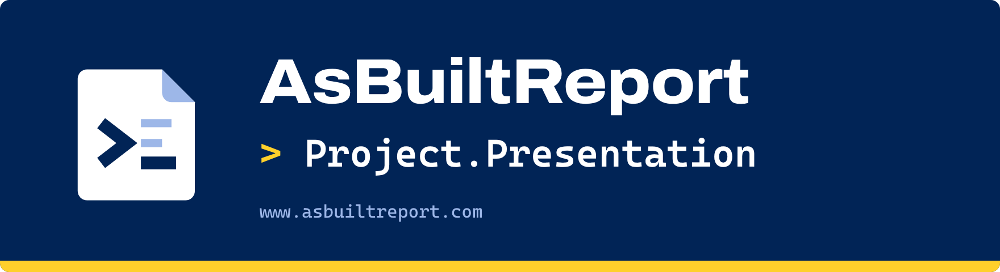

<p align="center">
    <a href="https://www.asbuiltreport.com/">
        
    </a>
</p>

A ready-made slide deck for introducing [AsBuiltReport](https://www.asbuiltreport.com) at meetups, user groups and other community events. It covers the background of the project, how it works and what it is good for, and leaves room for you to add a demo or your own story.

The deck is written in Markdown with [Marp](https://marp.app), so changes are tracked in Git and anyone can improve it with a pull request.

## What is in the deck

The core talk runs for about 20 minutes. An optional section adds 10 to 15 minutes for a live demo or a personal use case.

| # | Slide | Time |
|---|---|---|
| 1 | Title | 1 min |
| 2 | About me (yours) | 1 min |
| 3 | Nobody enjoys writing the as-built | 2 min |
| 4 | What is AsBuiltReport? | 1.5 min |
| 5 | Where it came from | 2 min |
| 6 | How it works | 1.5 min |
| 7 | Three commands to a finished report | 2 min |
| 8 | What you get | 1.5 min |
| 9 | Make it yours | 2 min |
| 10 | Where teams use it | 1.5 min |
| 11 | What it gives you back | 1 min |
| 12 | Demo (optional section) | |
| 13 | How I use AsBuiltReport (yours, optional) | 5 to 10 min |
| 14 | It is a community project | 1.5 min |
| 15 | Try it this week | 1 min |
| 16 | Thank you and questions | |

Every slide has a speaker script in its notes. Slides marked "yours" have a yellow bar across the top and are meant to be replaced.

## Get the deck

**To present it as it is,** download the PDF or PowerPoint file from the [latest release](../../releases/latest). The release also includes `speaker-script.txt`.

**To make it your own,** fork or clone this repository and edit `asbuiltreport.md`. See the [presenter guide](PRESENTER-GUIDE.md).

## Edit and build

The quickest way to edit is Visual Studio Code with the [Marp for VS Code](https://marketplace.visualstudio.com/items?itemName=marp-team.marp-vscode) extension. Open `asbuiltreport.md`, open the preview, and the slides update as you type. The repository settings load the AsBuiltReport theme for you. VS Code will ask you to trust the workspace first, which Marp needs for custom themes.

To build from the command line you need [Node.js](https://nodejs.org) 18 or later and Chrome, Edge or Chromium.

```powershell
npm install
npm run build
```

The files are written to `dist/`:

| File | Use |
|---|---|
| `AsBuiltReport.pdf` | Present from any PDF viewer. Speaker notes are included as annotations. |
| `AsBuiltReport.pptx` | Present from PowerPoint or Keynote, with the script in the notes pane. Slides are images, so edit the Markdown, not the PowerPoint file. |
| `index.html` | Present from a browser. Press `P` for presenter view with notes and a timer. |
| `speaker-script.txt` | The full script, to print or read on a tablet. |

`npm run watch` rebuilds the HTML version each time you save.

## Repository layout

| Path | Contents |
|---|---|
| `asbuiltreport.md` | The slides and the speaker script |
| `themes/asbuiltreport.css` | The Marp theme, following the AsBuiltReport brand guidelines |
| `assets/` | Logos, QR codes, the repository banner and the Archivo and Cascadia Code fonts |
| `themes/custom-example.css` | Example of a co-branded theme to copy |
| `THEMING.md` | How to apply your own company or event branding |
| `PRESENTER-GUIDE.md` | How to prepare, personalise and deliver the talk |
| `CONTRIBUTING.md` | How to propose changes |
| `.github/workflows/build.yml` | Builds the deck on every pull request and attaches it to releases |

## Branding

The deck follows the [AsBuiltReport brand guidelines](https://github.com/AsBuiltReport/AsBuiltReport.Project.Website#branding): console blue `#012456`, highlighter yellow `#FFD02B`, Archivo for text and Cascadia Code for code. Please keep to the theme when you contribute slides to this repository, so the shared deck stays consistent.

## Use your own branding

The deck follows the AsBuiltReport brand by default. If your employer or an event needs its own look, you can add a logo, change the colours and fonts, or switch to a different theme without editing the slides. See [THEMING.md](THEMING.md).

## Contributing

Corrections, clearer wording, better examples and new optional slides are all welcome. Read [CONTRIBUTING.md](CONTRIBUTING.md) first.

## Licence

The deck and theme are released under the [MIT licence](LICENSE). The fonts are licensed under the SIL Open Font License, and their licence files are in `assets/fonts/`.
